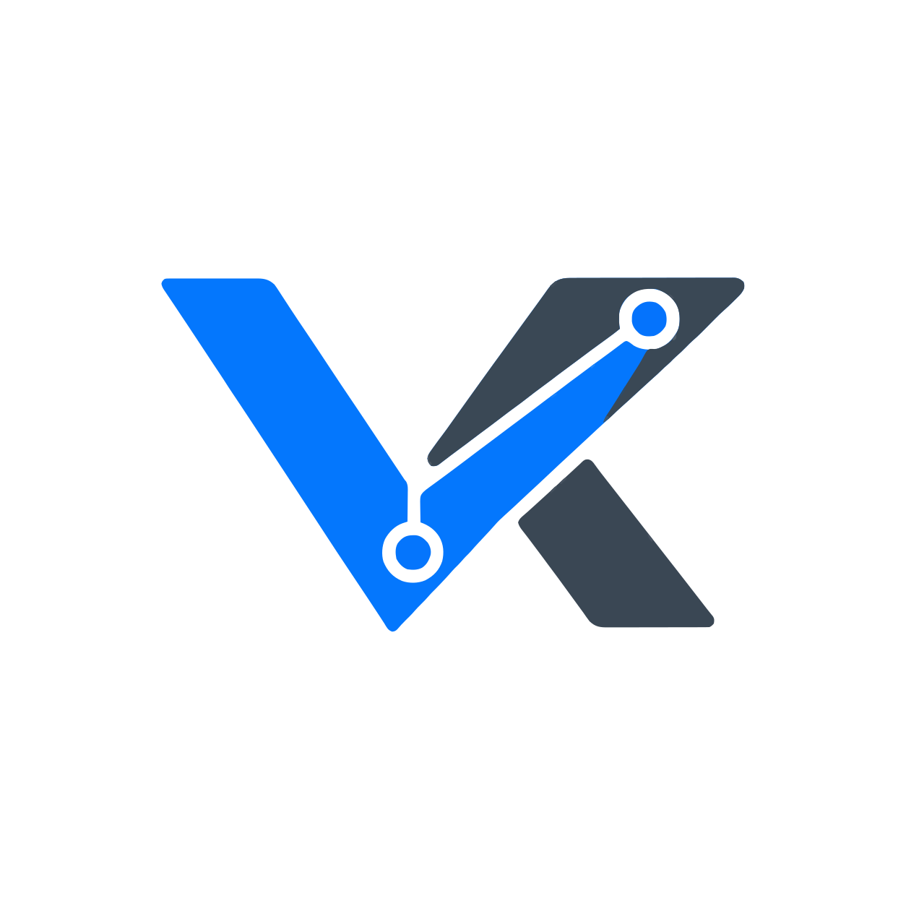

  

<h1 align="center">ValenceKit</h1>

  
  
  
  
  
  
  
  
  

  
  
  
  
  

ValenceKit is a Laravel and Vue.js boilerplate.

The name comes from chemistry, where valence electrons form bonds between atoms. Here, the boilerplate acts as the bond between the Laravel backend and the Vue.js frontend.

It is built for Inertia.js, which bridges the two frameworks so you can build single-page applications without a detached REST API. It also supports standard API and SPA architectures.

## Documentation

- [Inertia SSR setup and maintenance](./SSR.md)
